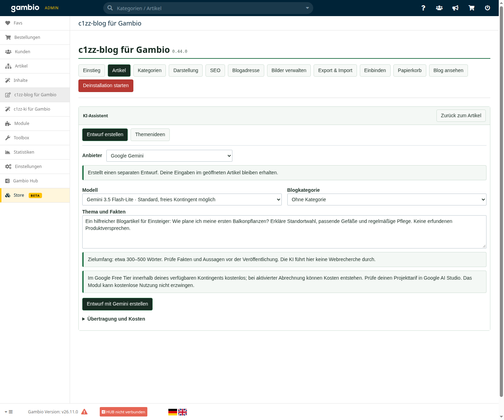

# c1zz-ki für Gambio

**Testrelease 0.8.3-rc.1 · Modulstand 0.8.3 · separat installierbare Erweiterung**

Neue Themen finden und Blogentwürfe erstellen, direkt in **c1zz-blog für Gambio**. Das KI-Modul verwaltet deine Anbieterzugänge und die aktivierten Bereiche. Der Assistent öffnet sich beim Artikel unter der vorhandenen Blognavigation und nutzt den gesamten Inhaltsbereich.

[Installer herunterladen](https://github.com/c1zz/gambio-ki/releases/download/v0.8.3-rc.1/c1zz-ai-install-0.8.3.php) · [Prüfsumme](SHA256SUMS) · [Installation](docs/INSTALLATION.md) · [Bilderrundgang](docs/BILDERRUNDGANG.md) · [Teststand](docs/TESTSTAND.md)

## Klare Einrichtung, kompakter Assistent

Erfolgreich geprüfte Zugänge tragen einen **grünen Haken**. Ungeprüfte oder fehlgeschlagene Verbindungen sind gelb beziehungsweise rot markiert. Die schmalen Anbieterzeilen lassen sich zum Einrichten aufklappen. Ein Verbindungstest bestätigt weiterhin kein Guthaben oder Restkontingent.

Blog und KI-Modul verwenden denselben c1zz-systems-Stil. Der Assistent gruppiert Quellen, zeigt gespeicherte Ideen als kompakte Themenliste mit aufklappbarer Gliederung und scrollt mit der normalen Seite. Entfernen-Aktionen sind rot.

## Was du damit machen kannst

- **Artikelentwürfe erstellen:** Thema, gesicherte Fakten und gewünschte Blogkategorie angeben. Der Text wird als neuer, bearbeitbarer Entwurf gespeichert. Veröffentlichen bleibt eine eigene Aktion.
- **Themen planen:** Ausgewählte Artikeltitel, Teaser und Blogkategorien als Grundlage für Artikel- und Kategorievorschläge verwenden.
- **Auch mit leerem Blog starten:** Optional Shopname, aktive Produktkategorien und einige Produktnamen einbeziehen. Die erkannten Angaben sind vor dem Absenden sichtbar und lassen sich durch eine eigene Shopbeschreibung ergänzen.
- **Vorschläge behalten:** Erfolgreiche Ideen werden im persönlichen Admin-Verlauf gespeichert. Neuladen und erneutes Anmelden erhalten die Ergebnisse. Der Wechsel im Dropdown lädt den gewählten Vorschlagssatz direkt, ohne weiteren KI-Aufruf.
- **Ideen weiterverwenden:** Eine Artikelidee mit einem Klick als Thema für einen neuen Entwurf übernehmen.

## Anbieter und Kosten

| Anbieter | Kleines Standardmodell | Tatsächlicher Teststand |
|---|---|---|
| OpenAI | GPT-6 Luna | Echte Entwürfe und Themenideen bestätigt |
| Anthropic | Claude Haiku 5.5 | Simulierte Antworten und Fehlerfälle geprüft |
| Google Gemini | Gemini 3.5 Flash-Lite | Echte Entwürfe, Themenideen und Verlauf vom Nutzer bestätigt |

Du brauchst einen eigenen API-Schlüssel. OpenAI und Anthropic werden über das jeweilige API-Konto abgerechnet. Gemini kann im Google Free Tier innerhalb des verfügbaren Kontingents kostenlos genutzt werden; bei aktivierter Google-Abrechnung können Kosten entstehen. Das Modul kann den Tarif nicht erkennen oder kostenlose Nutzung erzwingen. Maßgeblich sind die Bedingungen deines Anbieterprojekts.

OpenAI und Anthropic bieten außerdem ein größeres Modell mit ausdrücklicher Bestätigung. Kein automatischer Modellwechsel und keine automatischen Wiederholungen bei Fehlern. Bilderzeugung, Webrecherche und Anmeldung über ein Chat-Abonnement sind in diesem Testrelease nicht enthalten.

## In Gambio eingebunden

Native Adminanmeldung, Modul-Center-Rechte und Formularschutz bleiben maßgeblich. Erstellte Texte nutzen dieselbe Entwurfsspeicherung und denselben Gambio-Editor wie manuelle Blogartikel. Die Einbindung erfolgt über ein eigenes Modul unter `GXModules/c1zz/BlogAI/` und einen Gambio-Overload; es werden keine Gambio-Kerndateien verändert.

API-Schlüssel werden verschlüsselt gespeichert und später nicht wieder im Formular angezeigt. Der Verbindungstest liest nur die Modellliste. Inhalte werden erst nach dem ausdrücklichen Start an den ausgewählten Anbieter übertragen.

## Installation und Entfernung

Voraussetzung ist ein aktiviertes **[c1zz-blog ab 0.42.0](https://github.com/c1zz/gambio-blog)**; für den gemeinsamen Stil wird **0.43.0** empfohlen. Geprüft ist GX26.11.0 mit PHP 8.2.31, MariaDB 10.10 und Malibu. Dieser Teststand ist keine Freigabe für andere Versionen oder Themes.

1. PHP-Installer und Prüfsumme zusammen herunterladen und prüfen.
2. Nur `c1zz-ai-install-0.8.3.php` in den Shopordner hochladen und im Browser öffnen.
3. Nativ als Admin anmelden und die Installation ausdrücklich starten. Der Installer entfernt sich nach erfolgreichem Abschluss.
4. Im KI-Modul einen Anbieter verbinden, testen und den Bereich Blog aktivieren.
5. Im Blog bei **Neuer Artikel → KI-Assistent** beginnen.

Bei der normalen Deinstallation werden Zugänge und aktive Einbindungen entfernt. Blogartikel, Medien und gespeicherte Themenvorschläge bleiben erhalten. Eine Wiederinstallation benötigt neue Anbieterzugänge. Details und Sicherungshinweise stehen in der [Installationsanleitung](docs/INSTALLATION.md).

Die fünf [Abbildungen](docs/BILDERRUNDGANG.md) zeigen die echte Oberfläche im lokalen Testshop mit beispielhaften redaktionellen Texten. Sie zeigen keine API-Schlüssel und dokumentieren keine zusätzlichen Anbieteraufrufe.
