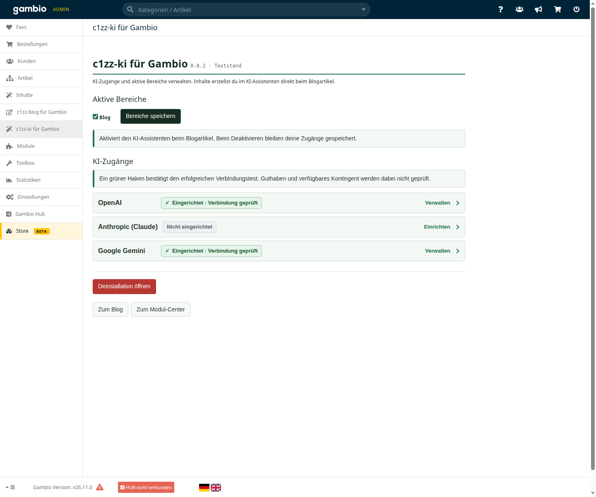
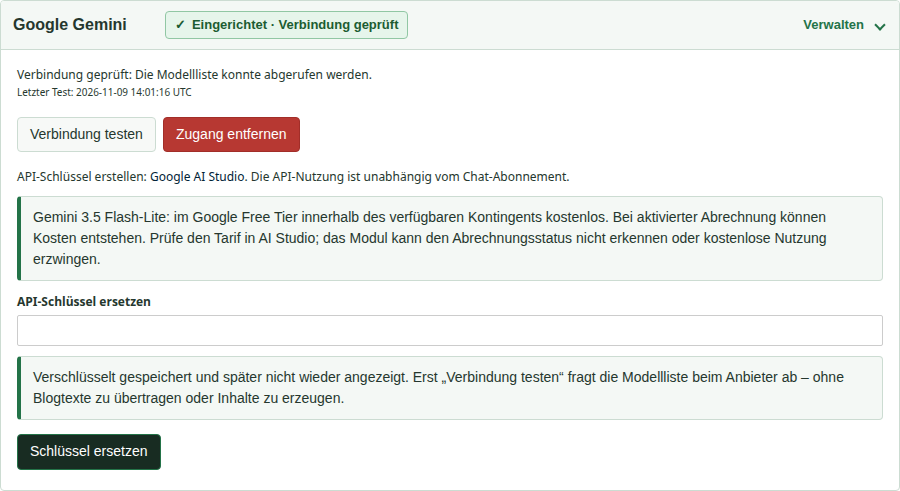
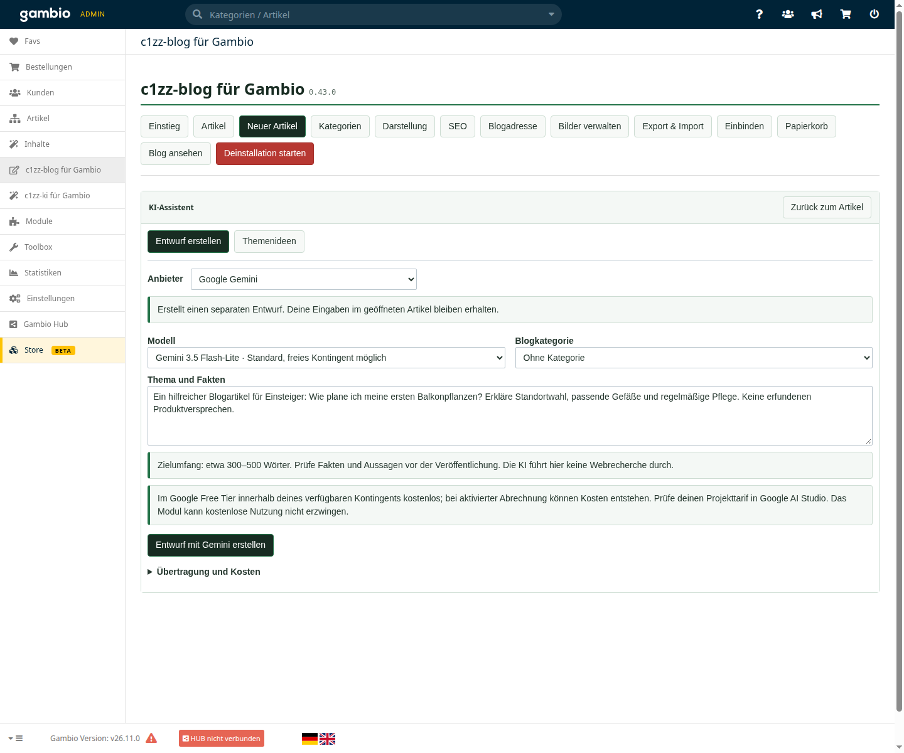
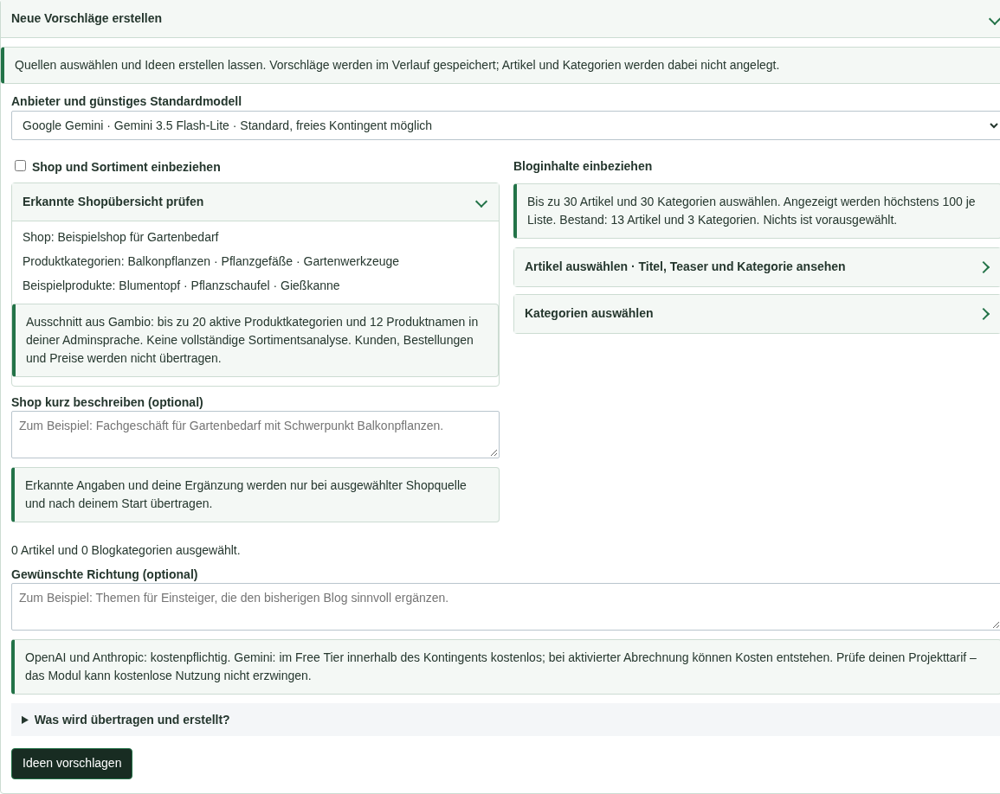
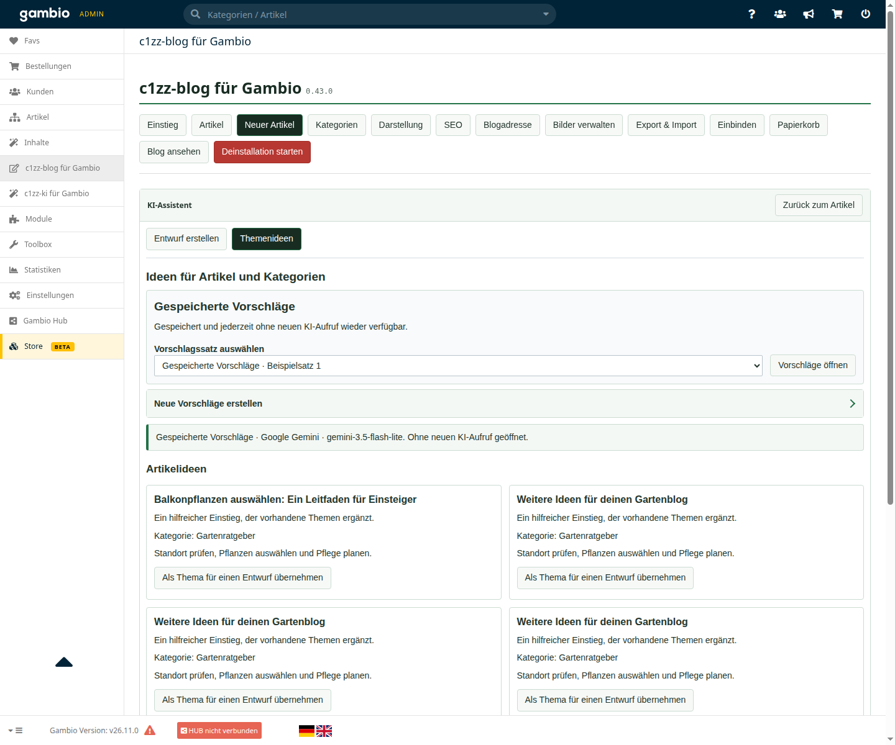

# c1zz-ki für Gambio – Bilderrundgang

**0.8.2-rc.1 · Modulstand 0.8.2**

Fünf Ansichten zeigen den Arbeitsablauf im lokalen GX26-Testshop. Die redaktionellen Beispieltexte und Shopangaben wurden ausschließlich für die Abbildungen in der Browseransicht eingesetzt. Keine gespeicherten Nutzerdaten wurden dadurch geändert. API-Schlüsselfelder sind leer; die Aufnahmen lösten keine KI-Anfragen aus.

## 1. Bereiche und Anbieter verwalten

Im KI-Modul werden die Zugänge verwaltet und die gewünschten Einsatzbereiche aktiviert. Derzeit steht der Blog zur Verfügung. Die redaktionellen Werkzeuge liegen direkt im Blog.

## 2. Gemini verbinden

Schlüsselverwaltung, Ergebnis des Modelllistentests und Hinweise zum kostenlosen Kontingent. Ein erfolgreicher Modelltest ist keine Zusage kostenloser Generierung.

## 3. Einen Entwurf vorbereiten

Der Assistent nutzt den Inhaltsbereich unter der bestehenden Blognavigation. Anbieter, Modell, redaktioneller Auftrag und Kategorie sind an einer Stelle. Der abgebildete Beispielauftrag wurde nicht abgesendet.

## 4. Quellen für neue Themen auswählen

Die optionale Shopübersicht hilft auch bei einem leeren Blog. Vorhandene Blogartikel und Kategorien lassen sich zusätzlich gezielt auswählen. Angaben sind vor dem Start einsehbar.

## 5. Gespeicherte Ideen weiterverwenden

Vorhandene Vorschläge werden ohne erneuten KI-Aufruf geöffnet. Eine Artikelidee lässt sich als Thema in die Entwurfserstellung übernehmen. Neue Anfragen sind getrennt aufklappbar.

