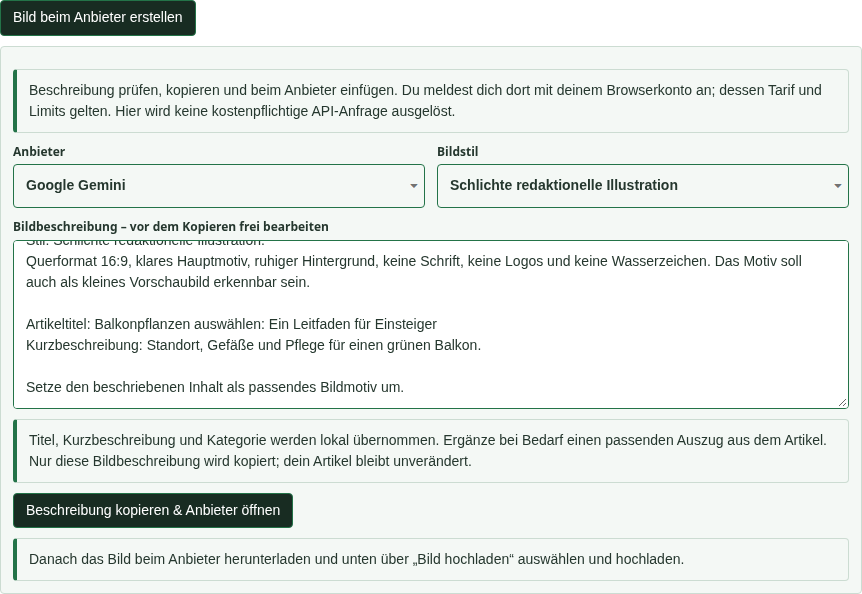
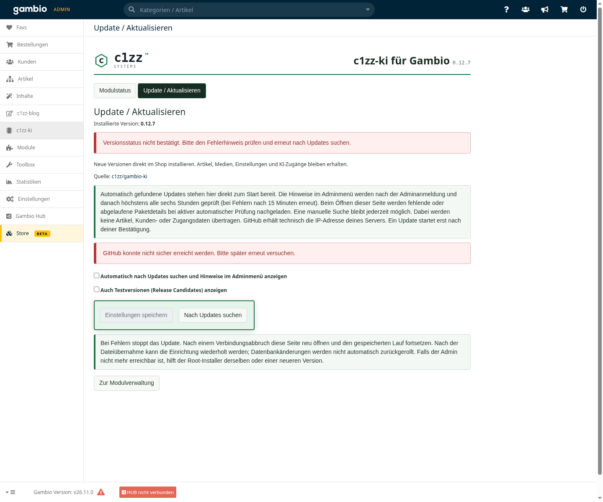

# c1zz-ki für Gambio – Bilderrundgang

**0.12.7-rc.1 · Modulstand 0.12.7 · Blog 0.48.16**

Alle Abbildungen wurden am 11.11.2026 neu aufgenommen. Sieben Ansichten zeigen den Arbeitsablauf im lokalen GX26-Testshop. Die redaktionellen Beispieltexte und Shopangaben wurden ausschließlich für die Abbildungen in der Browseransicht eingesetzt. Keine gespeicherten Nutzerdaten wurden dadurch geändert. API-Schlüsselfelder sind leer; die Aufnahmen lösten keine KI-Anfragen aus.

## 1. Bereiche und Anbieter verwalten

Im KI-Modul werden die Zugänge verwaltet und die gewünschten Einsatzbereiche aktiviert. Derzeit steht der Blog zur Verfügung. Die redaktionellen Werkzeuge liegen direkt im Blog.

## 2. Gemini verbinden

Schlüsselverwaltung, Ergebnis des Modelllistentests und Hinweise zum kostenlosen Kontingent. Ein erfolgreicher Modelltest ist keine Zusage kostenloser Generierung.

## 3. Einen Entwurf vorbereiten

Der Assistent nutzt den Inhaltsbereich unter der bestehenden Blognavigation. Anbieter, Modell, redaktioneller Auftrag und Kategorie sind an einer Stelle. Der abgebildete Beispielauftrag wurde nicht abgesendet.

## 4. Quellen für neue Themen auswählen

Die optionale Shopübersicht hilft auch bei einem leeren Blog. Vorhandene Blogartikel und Kategorien lassen sich zusätzlich gezielt auswählen. Angaben sind vor dem Start einsehbar.

## 5. Gespeicherte Ideen weiterverwenden

Die Auswahl im Dropdown lädt den gespeicherten Vorschlagssatz direkt und ohne erneuten KI-Aufruf. Titel, Kategorie und Kurzbeschreibung stehen in kompakten Zeilen; die Gliederung lässt sich aufklappen. Eine Artikelidee lässt sich als Thema in die Entwurfserstellung übernehmen. Neue Anfragen sind getrennt aufklappbar.

## 6. Ein Blogbild im Browser erstellen

Die Bildhilfe liegt direkt beim Titelbild des Artikels. Beschreibung aus dem Artikel prüfen, Bildstil und Anbieter wählen, Text kopieren und auf der Anbieter-Webseite einfügen. Das fertige Bild wird anschließend über den vorhandenen Blogupload hinzugefügt. Die Abbildung zeigt eine lokal vorbereitete Beschreibung; kein Bild wurde für die Aufnahme generiert.

## 7. Updates direkt im Modul

Die Updateverwaltung zeigt die installierte Version, den letzten Prüfstatus und die Optionen für automatische Prüfungen und Testversionen. Erfolgreiche Updates erscheinen anschließend kompakt mit aufklappbaren Details.

Die Aufnahme **Update / Aktualisieren** zeigt mit KI **0.12.7** die neue Seite nach frischer Installation. Automatisch gefundene Updates werden direkt mit Details und Startknopf angeboten. Für die Aufnahme blieb die automatische Prüfung ausgeschaltet; es wurde kein Update gestartet.

Alle sieben Aufnahmen zeigen den veröffentlichten Modulstand 0.12.7 zusammen mit Blog 0.48.16. Aufnahmedatum, Versionen und Bildprüfsummen stehen in [screenshots.json](screenshots.json).

Die temporäre Testumgebung verwendet ausschließlich synthetische Anbieter- und Ideenfixtures zur Darstellung der Bedienung. Der angezeigte Verbindungsstatus ist kein Nachweis eines aktuellen Anbietertests. Es wurden keine echten Schlüssel verwendet und keine KI-Anfragen ausgelöst.

Die Update-Aufnahme zeigt den Fehlerhinweis für GitHub, weil die temporäre Prüfumgebung den Abruf nicht zuließ. Dieser Hinweis ist kein fehlgeschlagenes Modulupdate; eine Installation wurde nicht gestartet.
